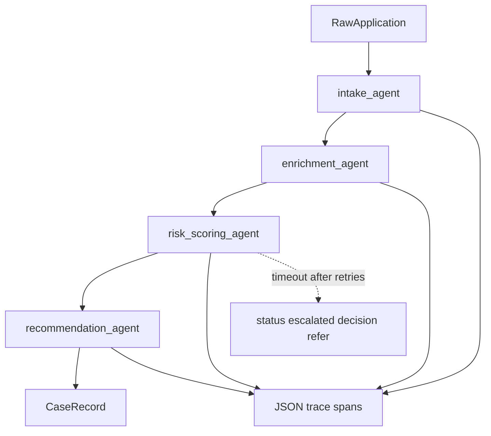

# Multi-Agent Underwriting Pipeline

The repo at [README.md](README.md) is an empty GitHub project (`nachiketht/insurance-orchestrator`). Everything below is new code. The lab PDF is assembled from screenshots of these artifacts; this plan builds the code, docs, traces, and CI run those screenshots come from.

## Architecture choice

This is a **fixed workflow** (prompt chaining), not an open-ended agent loop. Intake, enrichment, risk scoring, and recommendation always run in that order. Anthropic's [Building Effective Agents](https://www.anthropic.com/engineering/building-effective-agents) recommends a workflow when the steps are known ahead of time. A router or a tool-calling loop would add branching we do not need and would make traces harder to compare across cases.

We will **not** use LangGraph, CrewAI, or similar. The coordination is four function calls. A framework would hide the handoff the lab asks us to see.



## Part 1: State and memory

**Choice: a shared case record, not pure message passing.**

A case file is the real underwriting object. The recommendation needs intake, enrichment, and the risk score together. Pure message passing would still grow into one nested payload by the last step, which is a case record with a worse name. A shared record also lets a failed step leave the earlier sections intact for a human reviewer.

**Discipline so the shared dict does not become hidden coupling:** each agent may read the sections it needs and may write only its own field. Nothing else mutates `case.intake` except `intake_agent`.

Memory is **per case only**. Applications do not share history, so there is no vector store and no cross-case database. The record lives in memory during a run and is written to `traces/<trace_id>.json` so a run can be replayed from disk.

Document this in [docs/design.md](docs/design.md) (this is the screenshot for the state/memory decision). Include the read/write table in prose:

- `intake_agent` reads the raw application. Writes `case.intake`: normalized fields, missing-field list, notes. Does not invent values for fields the applicant left blank.
- `enrichment_agent` reads `case.intake` plus a local bureau lookup. Writes `case.enrichment`: credit band, prior-claim count, asset factor, flags, notes.
- `risk_scoring_agent` reads intake and enrichment. Writes `case.risk`: integer score 0–100 (higher is worse), factor list, rationale.
- `recommendation_agent` reads intake, enrichment, and risk. Writes `case.recommendation`: `approve`, `deny`, or `refer`, plus reasons. If risk was escalated, this agent is not asked to invent a score; the pipeline forces `refer`.

Case shape in [src/underwriting/models.py](src/underwriting/models.py) using Pydantic v2:

- `RawApplication`: `applicant_name`, `date_of_birth`, `address`, `product` (`auto` | `home` | `life`), `coverage_amount`, optional `stated_income`, optional `claims_history_text`.
- `CaseRecord`: `case_id` (uuid4), `raw`, `intake`, `enrichment`, `risk`, `recommendation`, `status` (`in_progress` | `completed` | `escalated`).
- One result model per agent, so a unit test can validate an agent without constructing a full case.

`case_id` is generated in `CaseRecord.new(raw)` before any agent runs, and every span carries it.

## Part 2: Standalone agents

Each agent is a plain function. It does not import the orchestrator. Signature pattern:

```python
def intake_agent(raw: RawApplication, *, llm: LLMClient) -> IntakeResult:
```

The `llm` argument is how tests inject a fake and how the pipeline injects the real client. No global client.

### LLM boundary

[src/underwriting/llm.py](src/underwriting/llm.py) defines a small protocol:

- `complete(system: str, user: str) -> LLMResponse`
- `LLMResponse` has `text`, `input_tokens`, `output_tokens`, `model`

Two implementations:

- `AnthropicClient` calls the official `anthropic` SDK (`messages.create`), model from `UNDERWRITING_MODEL` defaulting to a current Sonnet id, `temperature=0`, `max_tokens` capped per agent (intake 800, enrichment 800, risk 1000, recommendation 800). Token counts come from `response.usage`, not from a local estimator.
- `ScriptedClient` returns a canned JSON string and fixed token counts. Unit tests and CI use only this. No network, no API key.

A helper `parse_json_model(text, Model)` strips optional markdown fences, `json.loads`, then `Model.model_validate`. If validation fails, the agent makes **one** repair call that includes the validation error. That inner repair is separate from Part 5's timeout policy. If the repair also fails, the agent raises `AgentOutputError`. The pipeline treats that like any other agent failure for that step.

Prompts live next to each agent as constants. Each system prompt says: return only a JSON object matching the schema, do not add keys, do not guess missing applicant facts, use null or an empty list when data is absent.

### What each agent actually does

**Intake** ([src/underwriting/agents/intake.py](src/underwriting/agents/intake.py)): the LLM normalizes the raw dict into the schema and lists missing critical fields (`date_of_birth`, `product`, `coverage_amount`). Code checks those three after the LLM returns; the model's `missing_fields` is not trusted blindly. A date that does not parse as ISO `YYYY-MM-DD` is added to `missing_fields` and the normalized value is left null.

**Enrichment** ([src/underwriting/agents/enrichment.py](src/underwriting/agents/enrichment.py) and [src/underwriting/bureau.py](src/underwriting/bureau.py)): structured facts come from a local dict keyed by normalized applicant name, not from the LLM. Known fixtures return `credit_band` (`a`–`d` or `no_hit`), `prior_claims_count`, and `asset_age_years`. Unknown names return `no_hit`. The LLM only interprets those facts into `flags` and `notes`. This split is the integration pattern: the tool result is deterministic; the model does not get to invent a credit score.

**Risk** ([src/underwriting/agents/risk.py](src/underwriting/agents/risk.py)): the LLM returns `score`, `factors` (`name`, `points`, `detail`), and `rationale`. Code then clamps `score` to 0–100 and checks that factor points sum to the score within a tolerance of 5. A mismatch raises `AgentOutputError` rather than silently shipping a score that does not match its factors.

**Recommendation** ([src/underwriting/agents/recommendation.py](src/underwriting/agents/recommendation.py)): a **code gate runs before the LLM** so the model cannot approve a bad case.

- Missing critical field, or `credit_band == no_hit`: decision is `refer`.
- Score 0–30: `approve`. Score 31–60: `refer`. Score 61–100: `deny`.
- The LLM writes `reasons` and optional `conditions` for the decision code already chose. The parsed decision field must equal the gate. If it does not, code overwrites it and appends a reason that the gate held.

### Unit tests

pytest, one file per agent under [tests/](tests/):

- Hardcoded `RawApplication` (and, for later agents, hardcoded prior sections).
- `ScriptedClient` with a known JSON body.
- Assert parsed types and a few concrete values (normalized product, a flag, score range, decision).
- One extra intake test where the scripted model omits `date_of_birth` and the missing-field check catches it.
- Tests do not call Anthropic.

Three fixture applications in [tests/fixtures.py](tests/fixtures.py), reused by the pipeline run:

- Clean auto applicant, low claims, credit band `a` (expect approve).
- Home applicant with several prior claims and a thin income relative to coverage (expect refer or deny once the scripted risk JSON says so).
- Life applicant with a bureau `no_hit` (expect refer from the gate).

Scripted risk JSON is written to match those expectations so the full-pipeline test is stable.

## Part 3: Pipeline and tracing

[src/underwriting/tracing.py](src/underwriting/tracing.py): a `Tracer` that opens a span around each agent call.

Each span records:

- `trace_id`, `span_id`, `parent_span_id` (parent is the pipeline span), `case_id`
- `agent`, `attempt`
- `started_at` and `ended_at` as ISO-8601 UTC
- `duration_ms` from `time.perf_counter` (not `time.time`, so the duration is not skewed by clock steps)
- `input` and `output` as the Pydantic `.model_dump(mode="json")` of what that agent was given and what it returned
- `usage`: `input_tokens`, `output_tokens`, `model`
- `status`: `ok`, `error`, `retry`, or `escalated`
- `error`: exception type and message, or null

`tracer.span(...)` is a context manager. On success it stores the output. On exception it stores the error, marks `error`, and reraises so the pipeline's retry wrapper still sees it. Spans append to a list and `tracer.dump()` writes one JSON file: `traces/<trace_id>.json`.

[src/underwriting/pipeline.py](src/underwriting/pipeline.py) `run_case(raw, llm, tracer) -> CaseRecord`:

1. Create the case record.
2. Call intake, assign `case.intake`.
3. Call enrichment with intake, assign `case.enrichment`.
4. Call risk inside the retry wrapper, assign `case.risk`.
5. Call recommendation, assign `case.recommendation`, set `status=completed`.

Build order while implementing, matching the lab: intake alone, then intake plus enrichment with a trace, confirm the second span's input contains the intake output, then add risk, then recommendation. The final code is the full chain; the intermediate checks happen while wiring it, and the pipeline test locks the handoff (enrichment input includes the intake applicant name and product).

[scripts/run_cases.py](scripts/run_cases.py) runs the three fixtures. If `ANTHROPIC_API_KEY` is set it uses `AnthropicClient`. If not, it uses `ScriptedClient` and still writes traces with the scripted token counts so cost math runs without a key. Prints the trace path and the decision for each case.

## Part 4: Cost and latency

[src/underwriting/pricing.py](src/underwriting/pricing.py) holds a price table in USD per million tokens, keyed by model id. At implementation time, fill it from Anthropic's published rates for the chosen model and cite the page in a comment. Cost of a span is `(input_tokens * input_price + output_tokens * output_price) / 1_000_000`. Case cost is the sum of spans. Latency is the pipeline span's `duration_ms` (wall clock), which equals the sum of agent spans because the chain is sequential, plus a few milliseconds of Python between them.

[scripts/analyze_traces.py](scripts/analyze_traces.py) reads the three trace files and writes [docs/cost_latency.md](docs/cost_latency.md) with per-case tokens, USD, and milliseconds, plus the average.

Written conclusion to include in that doc, adjusted if measured numbers differ:

- Four sequential model calls are typically several seconds to a few tens of seconds. A real-time quote UI wants a response in about one or two seconds, so this pipeline is the wrong shape for interactive quoting.
- An overnight batch is a fit: tens of seconds per application is fine when the queue runs unattended, a few cents per case is small next to a premium, and `refer` cases become a morning human queue.
- Say explicitly whether the numbers came from live Anthropic usage or from the scripted token counts.

## Part 5: Failure handling

Retry-then-escalate lives in the pipeline, not inside the risk agent's scoring logic.

- `RetryableError` subclasses include a `TimeoutError` raised by the LLM client.
- [src/underwriting/llm.py](src/underwriting/llm.py) `TimeoutRiskClient` wraps another client and raises `TimeoutError` only when the system prompt or a `simulate_timeout=True` flag is set, and only for the risk agent's calls. Other agents keep working. This is the deliberate fault for one test case.
- `call_with_retry` tries the risk agent up to 3 times (1 initial + 2 retries). Backoff is `0.05s` then `0.1s` so tests stay fast. Each failed attempt writes a span with `status=retry` and the attempt number.
- After the third failure the pipeline does **not** raise to the caller. It sets `case.status = "escalated"`, `case.risk = None`, and `case.recommendation = refer` with reason `risk scoring unavailable after 3 attempts`. It writes a final span with `status=escalated`. No score is fabricated.

Tests in [tests/test_failure.py](tests/test_failure.py):

- Always-timeout client: `run_case` returns normally, status is `escalated`, decision is `refer`, trace contains 3 risk attempts and no approve/deny.
- A second client that fails once then succeeds: decision is a normal recommendation, trace shows one `retry` span then an `ok` span. This proves retry is real, not an immediate escalate.

## Part 6: CI

[pyproject.toml](pyproject.toml): package `underwriting` under `src/`, Python `>=3.11`, dependencies `pydantic>=2` and `anthropic`. Dev dependency `pytest`.

[.github/workflows/ci.yml](.github/workflows/ci.yml): on push and pull_request, `ubuntu-latest`, `actions/setup-python` 3.12, `pip install -e ".[dev]"`, `pytest -q`. No API key. The workflow must pass on the scripted tests only.

Update [README.md](README.md) with how to run `pytest`, `python scripts/run_cases.py`, and `python scripts/analyze_traces.py`, and where the design and cost docs are.

## PDF screenshot order

After the code runs locally, capture, in this order: `docs/design.md`; pytest output for the four agent tests; `pipeline.py` and `models.py`; `tracing.py`; the three trace JSON files; `docs/cost_latency.md`; the failure test plus the retry/escalate function with pytest output; the GitHub Actions run page. Those screenshots are the lab PDF. The repo itself holds the source those shots are taken from.

## Implementation sequence

Follow the lab's staging even though the end state is one codebase: models and scripted LLM, intake test green, enrichment test green, risk test green, recommendation test green, then the two-agent handoff with tracing, then the other two agents, then the three-case script, then cost analysis, then the timeout injection and escalation tests, then the workflow file.